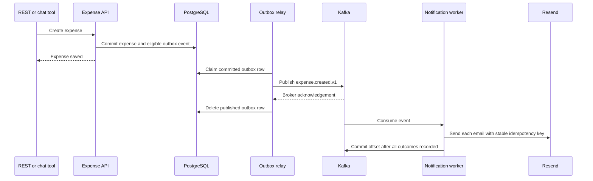

# Expense notification server design

When a merchant creates an expense through REST or chat, the expense API saves the expense and, for an opted-in account, an event in the same PostgreSQL transaction. A separate relay publishes committed events to Kafka. A dedicated NestJS worker named `notification-server` reads them and submits one private email per configured address to Resend. The worker has no database, public domain, or expense API credentials. The NestJS workforce API is outside this flow.

## Architecture flow

```mermaid
flowchart LR
    User["Merchant"] -->|Add expense via form or chat| API
    User -->|Configure notification emails| API

    subgraph Expense["Expense service"]
        API["FastAPI · shared expense creation"]
        DB[("PostgreSQL<br/>users · expenses · expense_outbox")]
        Relay["Outbox relay"]

        API -->|Save profile recipients| DB
        API -->|Commit expense and eligible outbox event together| DB
        DB -->|Read committed outbox events| Relay
        Relay -->|Delete outbox row after Kafka acknowledges| DB
    end

    API -->|Confirm expense save| User
    Relay -->|Publish event| Topic

    subgraph Kafka["Kafka"]
        Topic["expense.created.v1"]
        DLQ["expense.created.v1.dlq"]
    end

    Topic -->|Consume event with recipient snapshot| Worker
    Worker["notification-server<br/>Dedicated NestJS worker on Railway<br/>KafkaJS · no database"]
    Worker -->|Send one email per recipient with a stable idempotency key| Resend["Resend"]
    Resend --> Inbox["Configured inboxes"]
    Worker -->|Record invalid events and terminal send failures| DLQ
    Worker -.->|Commit offset after all outcomes are recorded| Kafka
```

## Expense creation sequence

**Profile.** Store up to five addresses in `users.notification_emails`, default empty. Use the existing merchant-only, CSRF-protected profile update. Omitted means unchanged; an explicit empty list disables future emails. The login address is unchanged. Recipients are snapshotted at creation; editing a profile or deleting an expense does not recall a queued email. Expense edits, deletes, failed creates, and existing expenses do not generate events. The save response and agent confirmation still describe the expense only.

**Privacy and rollout.** Start with a closed pilot on Railway. The operator registers consenting addresses in an allowlist keyed by merchant UUID. Server checks it on save and enqueue; invalid or revoked lists cannot silently become authorized for future sends. A public rollout with self-service recipients needs verified recipient consent, abuse limits and suppression handling before enabling notifications for untrusted accounts. Enriched events include the new expense amount and currency, the current Europe/Berlin month's EUR target, SQL category totals and remaining budget. Emails show these financial details in the subject and escaped HTML with a plain-text alternative. Totals are immutable snapshots taken at expense creation. Send to each address separately. Kafka contains email addresses, so restrict credentials, set short retention, and keep message bodies out of logs and the dead-letter topic. Rotate sender configuration only after draining outstanding v1 messages.

**Delivery.** The outbox closes the database-to-Kafka loss window without adding a worker database. Kafka publication and consumption are at least once; Resend deduplicates identical requests for a limited period. Every send uses the same key and body on replay. The worker stops sending 23 hours after event creation to stay inside Resend's 24-hour idempotency window. Late events and permanent or exhausted failures get a redacted dead-letter record. Monitor and investigate those failures; a Resend acceptance ID means accepted for delivery, not delivered to an inbox. The first version trades automatic delivery after a long outage for bounded duplicate risk. No historical backfill or automatic dead-letter replay.

**Deployment.** Reuse the existing Railway expense API image for a separate relay service. Use a managed Kafka cluster with SASL/TLS, a dedicated Node.js image for the NestJS worker, and a verified Resend sending domain. Apply the Alembic migration before enabling event capture. Start and verify workers before exposing profile settings for the pilot.
